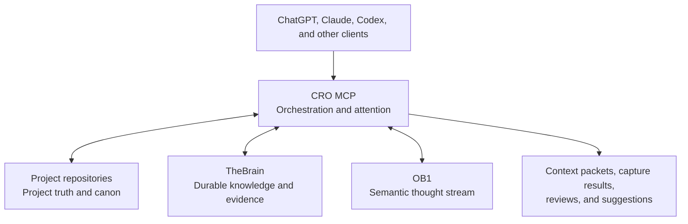
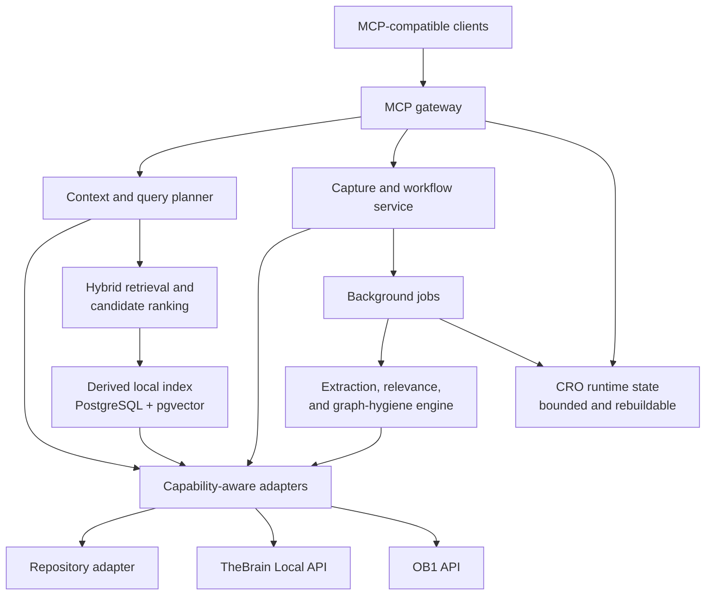
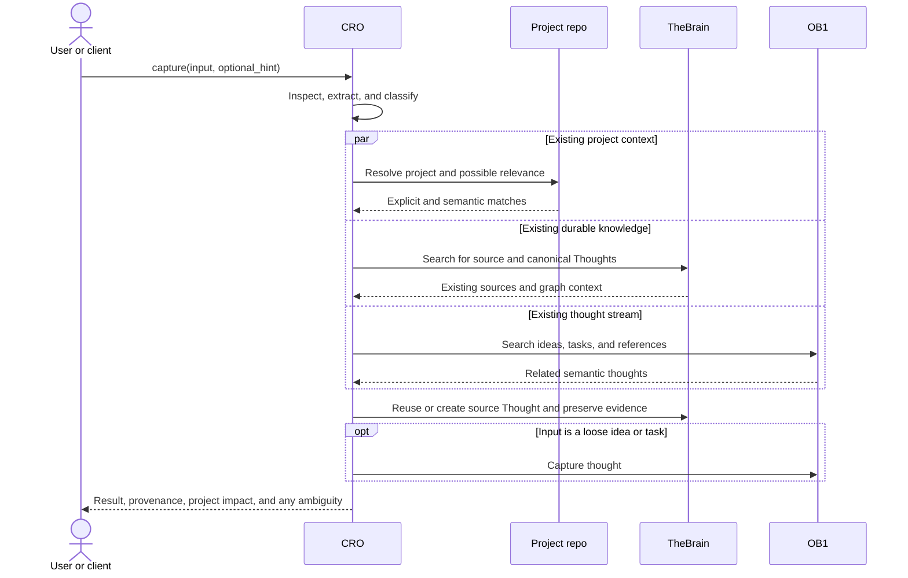
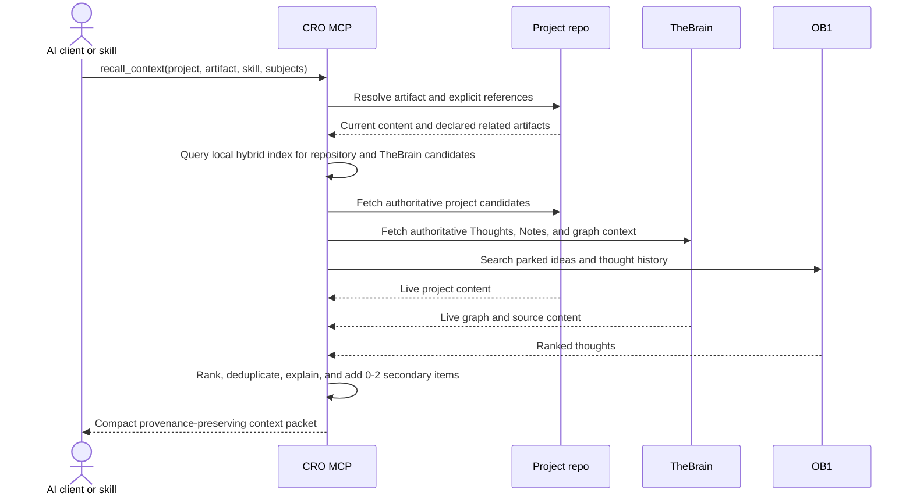
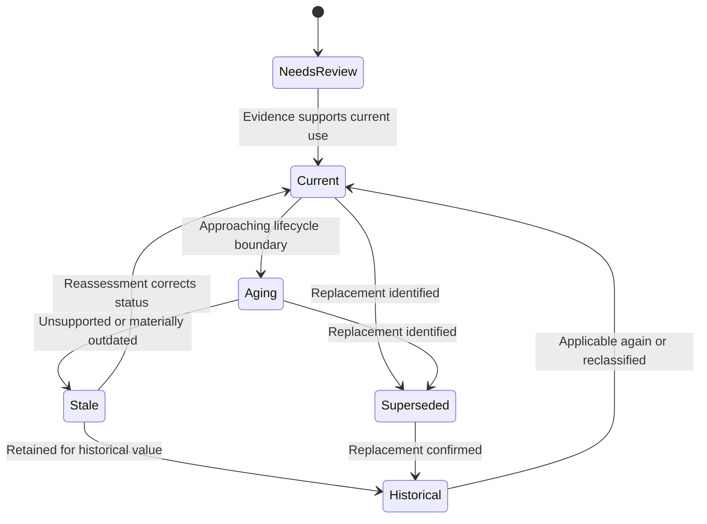

# Cognitive Research Orchestrator

## Technical Concept and System Architecture

**Status:** Approved concept architecture

**Version:** 0.3

**Date:** 2026-10-11
**Working name:** Cognitive Research Orchestrator (CRO)

> The working name is descriptive. Product naming remains open.

## 1. Executive Summary

CRO is a local-first, MCP-facing orchestration layer that helps AI clients capture information, recall relevant context, and maintain graph hygiene across the user's existing systems.

CRO coordinates three canonical owners:

- **Project repositories** hold approved project work, canon, decisions, skills, and runbooks.
- **TheBrain** holds durable knowledge, original sources, attachments, Notes, and meaningful relationships.
- **OB1 / Open Brain** holds the semantic thought stream: ideas, observations, tasks, references, and person notes.

CRO is not a fourth knowledge system. It owns behavior and orchestration, not user knowledge. Its durable storage is limited to bounded operational state, bounded audit history, and rebuildable technical caches. A disposable local retrieval index may contain derived text chunks and embeddings, but canonical content remains in TheBrain and project repositories and is fetched live before final use.

The guiding model is:

> The repo tells CRO what the user is working on. TheBrain tells it what the user knows. OB1 tells it what the user has thought about. CRO notices the intersections.

Primary goals:

1. Accept simple capture requests without requiring the user to choose a destination.
2. Preserve original evidence and provenance.
3. Surface relevant remembered or parked material during project work.
4. Follow authored project relationships before inferred relationships.
5. Keep TheBrain useful without requiring manual graph maintenance.
6. Preserve user involvement in creative and project decisions.

## 2. System Boundaries



See [01-cognitive-model.mmd](architecture/01-cognitive-model.mmd).

There are only two persistent personal knowledge or memory stores: TheBrain and OB1. Project repositories remain canonical for project artifacts. CRO may maintain infrastructure data, including a derived retrieval index, but that data must remain disposable and must not become another source of user truth.

The decision is recorded in [ADR 0001](adr/0001-data-ownership-and-storage-boundaries.md).

## 3. Canonical Ownership

| Owner | Owns | Does not own |
|---|---|---|
| Project repositories | Approved project artifacts, canon, decisions, manuscripts, cards, skills, runbooks, deliberately local research | General personal knowledge or unapproved brainstorms |
| TheBrain | Durable sources, documents, URLs, attachments, summaries, provenance, people, organizations, concepts, events, and meaningful relationships | Project canon merely copied for convenience |
| OB1 | Ideas, observations, tasks, references, person notes, thinking history, and user-behavior feedback worth remembering | Raw PDFs, full transcripts, or source archives |
| CRO | Jobs, retries, schedules, health, idempotency, bounded audit records, hashes, derived text chunks and embeddings, Git commit IDs, and other rebuildable indexes | Summaries, conclusions, ideas, project decisions, or durable relationship truth |

### 3.1 Repository ownership

Repositories are first-class context sources. CRO should understand:

- The current repo and project
- The active skill or task
- The supplied artifact or path
- Explicit references in cards, outlines, manifests, frontmatter, or other project artifacts
- Git state and artifact freshness where useful

CRO resolves the current project and artifact from repo context, the active skill, and the supplied artifact or path. It asks only when the remaining ambiguity is material.

### 3.2 TheBrain ownership

TheBrain is both the durable evidence store and the meaningful associative graph. It may contain:

- Sources and documents
- Original URLs and access information
- Attachments and transcripts
- Compact synthesized Notes
- People, organizations, technologies, places, projects, concepts, and events
- Thought Types and Tags
- Parent, child, jump, and typed relationships
- Calendar Events when an occurrence is genuinely worth calendaring

Notes hold synthesized knowledge. Attachments preserve the lossless source.

Thought titles are compact navigational identities, with an approximately 80-character soft limit unless an established Thought requires otherwise. Most useful textual material belongs in the Note. Because Local API discovery found that Note bodies are not reliably searchable, CRO must fetch and index Notes explicitly rather than rely on native TheBrain search.

### 3.3 OB1 ownership

OB1 is a semantic inbox and thinking history. Its known thought classes are:

- `observation`
- `task`
- `idea`
- `reference`
- `person_note`

Parked ideas belong here until the user chooses to promote them. Reading or resurfacing feedback also belongs in OB1 when it represents a durable user behavior, reaction, or thought.

Live capability discovery verified capture, fetch-by-ID, semantic search, recent listing, and metadata filters across all five classes. Capture accepts content only and infers classification. Semantic results omit IDs, so stable hydration may require a separate compatibility search. The exposed connector has no explicit update, delete, relationship, bulk, transaction, or cursor-pagination operations.

## 4. Architectural Principles

### 4.1 Use the cheapest useful representation

A fact does not become a Thought merely because CRO extracted it. Prefer:

- Note text for compact facts and synthesis
- Tags for state and reusable facets
- Attachments for original evidence
- Thoughts for durable independently navigable things
- Plex links only when future traversal has real value

### 4.2 Reuse before creating

CRO searches for exact and near-duplicate Thoughts before creation. High-confidence source capture may automatically reuse or create a Thought. CRO asks only when identity, placement, or relationship ambiguity is material.

### 4.3 Preserve intent under partial failure

Capture succeeds when the user's intent is safely preserved. Enrichment, transcription, or relationship discovery may complete later.

### 4.4 Keep evidence distinct from inference

Results and stored annotations must distinguish:

```text
source_fact
authoritative_external_fact
user_statement
user_confirmed_classification
ai_extraction
ai_inference
```

### 4.5 Do not silently change canon

CRO may surface parked or speculative ideas beside project work. It must not write them into project canon without the user's decision.

### 4.6 Bound serendipity

Context recall may include one or two secondary, non-obvious items. This preserves useful surprise without drowning the current task.

### 4.7 Avoid destructive automation

Graph cleanup, deduplication, retirement, and contradiction handling follow propose, review, and execute. CRO does not delete user knowledge automatically.

## 5. Logical Architecture



See [02-logical-architecture.mmd](architecture/02-logical-architecture.mmd).

### 5.1 MCP gateway

- Exposes task-oriented tools
- Validates requests and client permissions
- Normalizes errors and partial completion
- Preserves provenance
- Enforces confirmation policy for ambiguous or high-impact changes

### 5.2 Context and query planner

- Resolves project, skill, and current artifact
- Follows explicit repository references first
- Selects relevant adapters
- Runs independent reads concurrently
- Ranks and deduplicates without erasing native identity
- Adds at most one or two serendipitous results
- Explains why each item was included

### 5.3 Capture and workflow service

- Accepts heterogeneous inputs
- Preserves source material and user intent
- Routes durable results to TheBrain or OB1
- Proposes repo changes only when project integration is requested
- Coordinates retries and partial completion

### 5.4 Capability-aware adapters

Each adapter exposes only verified behavior:

```text
IContextSource
  search(query, filters)
  get(id)
  health()
  capabilities()

IWritableContextSource
  create(payload, idempotency_key)
  update(id, patch)
  link(source_id, target_id, relationship)
```

The current discovery status is recorded in [capability-matrix.md](capability-matrix.md).

### 5.5 Operational state

CRO may persist:

- Job checkpoints and bounded retry schedules
- Adapter health and cursors
- Idempotency records
- Short-lived context assembly state
- Bounded operational audit records
- Rebuildable hashes, embeddings, mappings, and Git identifiers

Retention must be explicit and bounded. Operational records must not evolve into summaries, conclusions, reading histories, project decisions, or another user-knowledge model.

### 5.6 Derived local retrieval index

TheBrain Note bodies are not reliably searchable through the Local API, and repository retrieval must cover both exact identifiers and conceptual matches. CRO therefore maintains a disposable local index over canonical sources.

The index may contain TheBrain titles and Notes, attachment metadata or safely extracted text, repository content, source hashes, chunks, embeddings, facets, relationships, and canonical identifiers. Retrieval combines:

- Exact and full-text matching
- Semantic/vector matching
- Metadata filtering
- Relationship-aware expansion

Large Notes and documents are indexed as content-aware chunks that retain their parent canonical identifier. Search returns candidate IDs; CRO then fetches live authoritative content from TheBrain or the repository before producing a final context packet.

The preferred infrastructure is local PostgreSQL/Supabase with `pgvector`. CRO-owned `cro_index` and `cro_runtime` schemas or databases must remain separate from OB1-owned storage, even if they share a PostgreSQL server. Deleting and rebuilding the CRO index must never destroy user knowledge.

## 6. TheBrain Modeling Rules

### 6.1 Thoughts

Create a Thought for a durable thing worth independent navigation or retrieval, such as a person, organization, project, technology, concept, event, place, source, document, or book.

Keep its title short and navigable, using approximately 80 characters as a soft limit. Put summaries, URLs, extracted facts, provenance, source context, historical detail, and CRO annotations in the Note.

Keep the controlled Thought Type vocabulary small. Candidate types include:

```text
Person, Organization, Project, Software, Technology, Concept,
Event, Place, Source, Document, Book, Task, Decision, Topic
```

### 6.2 Tags

Tags express reusable characteristics or state. Initial examples include:

- `Incomplete`
- `Needs Review`
- `Stale`
- `Superseded`
- `Personal`
- `Work`
- `YouTube`
- `Historical`

There is no `Complete` tag. Absence of `Incomplete` represents normal completion.

### 6.3 Notes and attachments

Notes may contain compact summaries, extracted concepts, provenance, source metadata, historical context, and key claims. Full large documents should remain attachments unless a verified API limitation requires a reviewed fallback. Note bodies require explicit reads and derived indexing because native search did not reliably find newly written Note content.

Attachments preserve PDFs, DOCX files, Markdown, transcripts, VTT files, HTML snapshots, images, screenshots, and other original evidence.

### 6.4 Links and graph hygiene

Links are expensive and should remain meaningful. CRO should:

- Reuse canonical anchor Thoughts
- Avoid connecting every extracted entity
- Detect duplicate and near-duplicate Thoughts
- Detect orphan Thoughts and pathological hubs
- Identify stale software-version Thoughts
- Identify contradictory relationships
- Suggest a small number of high-value links

When supported, a relationship includes endpoints, Plex relation, direction, and Link Type.

### 6.5 Time

Keep these time concepts distinct:

1. Thought creation and modification time
2. Source publication date
3. Historical or subject date
4. Calendar Event date
5. Last externally verified date

Existing Month and Year Thoughts may remain useful navigation anchors. They are not automatically replaced with Tags.

## 7. General Capture Pipeline

The conceptual MCP operation is:

```text
capture(input, optional_hint)
```

Supported input classes should include:

- URL
- PDF, DOCX, Markdown, or text file
- Pasted text
- Image or screenshot
- ZIP or archive
- YouTube URL, transcript, or VTT file
- A user idea with no external source
- Multiple heterogeneous files



See [03-capture-flow.mmd](architecture/03-capture-flow.mmd).

### 7.1 Processing steps

1. Preserve the input and user note.
2. Inspect and extract metadata, text, entities, dates, and source type.
3. Resolve possible project relevance.
4. Search TheBrain and OB1 for existing canonical or related material.
5. Reuse existing Thoughts where possible.
6. Create the minimum durable structure needed.
7. Commit high-confidence capture automatically.
8. Ask only when ambiguity would materially change identity, placement, or meaning.
9. Report provenance, completeness, and possible project impact.

### 7.2 Partial completion

If enrichment fails, preserve the source and user note, add `Incomplete`, record a concise human-visible reason where useful, and schedule bounded retry state in CRO.

A default retry pattern for transient failures is:

```text
5 minutes -> 30 minutes -> 2 hours -> 12 hours -> next day
```

Retries must be bounded and adapter-specific. When the missing enrichment succeeds, remove `Incomplete`. Do not add `Complete`.

### 7.3 Source preservation

When material matters, TheBrain should retain the original URL, access date, source attachment, transcript or captions when available, a compact Note, and an optional checksum. External archive links may supplement this copy but must not be the only durable evidence.

## 8. Context Recall and Project Integration



See [04-federated-query.mmd](architecture/04-federated-query.mmd).

Retrieval order is:

1. Current artifact
2. Explicit repository references
3. Hybrid-index candidates from exact, semantic, metadata, and relationship signals
4. Live repository and TheBrain hydration by canonical ID
5. Direct OB1 semantic and metadata retrieval
6. Zero to two bounded serendipity items

This supports both directions:

- **Impact forward:** what existing project material could a new capture affect?
- **Recall backward:** what previously captured material could matter to the current artifact?

## 9. Skill Integration

Skills declare their CRO requirements in a standard block inside the skill file. The initial schema is:

```yaml
cro_context:
  version: 1
  artifact: supplied_or_active
  explicit_references:
    - character_cards
    - worldbuilding_cards
    - plot_artifacts
  search:
    - repository
    - thebrain
    - ob1
  serendipity_limit: 2
  post_skill:
    - decisions
    - canon_candidates
    - unresolved_questions
    - parked_ideas
    - research_needs
    - tasks
```

The block is declarative. It describes context needs and possible outputs; it does not authorize writes by itself.

### 9.1 Pre-skill hook

1. Resolve repo, project, skill, and artifact.
2. Read author-declared references.
3. Build working semantic context.
4. Search the repository, TheBrain, and OB1 in the defined order.
5. Return a compact context packet.

### 9.2 Post-skill hook

Detect decisions, canon candidates, unresolved questions, parked ideas, research needs, contradictions, and tasks. Propose persistence according to canonical ownership. Do not silently promote brainstorms into canon.

## 10. Proposed MCP Surface

### 10.1 Primary tools

```text
capture(input, optional_hint?)

recall_context(
    project?,
    current_artifact?,
    skill_or_task?,
    subjects?
)

find_related(query)
find_when(query)
explore(topic)
review_incomplete()
review_stale()
suggest_connections(thought)
explain_path(source, target)
```

### 10.2 Supporting tools

```text
get_system_health()
get_capabilities(system?)
get_pending_suggestions(type?, limit?)
approve_suggestion(suggestion_id)
reject_suggestion(suggestion_id, reason?)
```

Reading queues, forgotten gems, replacement review, and maintenance digests remain useful later features. They should build on the primary task-oriented surface rather than expose storage mechanics.

### 10.3 Mutation policy

| Action | Default policy |
|---|---|
| Search and context assembly | Automatic |
| Reuse an unambiguous TheBrain Thought | Automatic |
| Create a high-confidence source Thought | Automatic |
| Preserve an original source attachment | Automatic when capability and policy permit |
| Capture an explicitly stated loose idea or task in OB1 | Automatic |
| Resolve material identity or placement ambiguity | Ask |
| Create speculative graph relationships | Suggest first |
| Promote a brainstorm into project canon | Ask |
| Destructive graph cleanup | Propose, review, execute |
| Delete user knowledge | Never automatically |

## 11. Relevance, Volatility, and Trust

Source volatility is computed from source type, subject, age, ecosystem, and current evidence. Persist it in TheBrain only when useful to the user.

Typical relative volatility:

| Domain | Typical volatility |
|---|---|
| History and biography | Low |
| Established science | Low |
| Recent science | Medium |
| Software | High |
| AI tools and models | Very high |

Age alone does not determine relevance. A source can be technically stale while remaining conceptually or historically valuable.

Each surfaced result should be able to explain:

- Canonical owner and native identifier
- Why it matched
- Whether the relationship was explicit or inferred
- Relevant dates and their meanings
- Currency or incompleteness warning
- Source evidence versus CRO inference

## 12. Relevance Lifecycle

The source-currency lifecycle remains separate from capture-processing completion:



See [05-relevance-lifecycle.mmd](architecture/05-relevance-lifecycle.mmd).

`Incomplete` means an expected capture or enrichment step remains outstanding. It does not mean the source is stale.

## 13. Security and Privacy

- Keep TheBrain's Local API on the local or explicitly trusted network boundary.
- Store API keys outside source control and logs.
- Separate read and write privileges where supported.
- Treat source documents as untrusted input, never as system instructions.
- Validate structured extraction output before writes.
- Apply client authentication and per-client authorization.
- Record bounded operational audit events for significant actions.
- Never claim atomicity across independent systems.
- Keep sensitive source text, derived chunks, and embeddings inside the trusted home environment.
- Do not expose CRO, TheBrain, OB1, local databases, or the MCP endpoint directly to the public internet.

An audit record may include client identity, tool, systems accessed, policy decision, native identifiers, result status, timestamp, and correlation identifier. It must not accumulate source summaries or become a substitute knowledge history.

### 13.1 Local-first deployment boundary

CRO, TheBrain, OB1, project repositories, and the PostgreSQL/Supabase retrieval infrastructure belong inside the trusted home environment. Sensitive material and its derived representations must never be synchronized to a cloud CRO knowledge service.

Remote capture is a future system, not MVP scope. Its allowed cloud footprint is a deliberately dumb authenticated inbound queue containing only temporary capture payloads and minimal routing state. The home system initiates outbound pulls; the cloud service receives no trusted retrieval access and cannot initiate arbitrary connections into the home network.

Everything arriving through that queue is untrusted data, never instructions. A future ingestion worker must use capability isolation: quarantine inputs, validate type and size, scan and safely extract content, reject active or executable material where appropriate, preserve external provenance, and operate without shell access, arbitrary MCP tools, private TheBrain reads, or unrestricted LAN access.

Remote URL fetching must reject loopback, private, link-local, and internal destinations and eventually defend against redirects and DNS rebinding. See [06-local-first-boundary.mmd](architecture/06-local-first-boundary.mmd).

## 14. Reliability and Operations

- Degrade individual adapter capabilities instead of failing all retrieval.
- Use idempotency keys for writes.
- Retry transient failures with bounded backoff.
- Report partial completion explicitly.
- Keep jobs restartable and checkpointed.
- Back up project repos, TheBrain, and OB1 through their supported mechanisms.
- Rebuild caches from canonical systems wherever possible.

Minimum operational signals include adapter health, capture backlog, enrichment failures, retry backlog, query latency, incomplete captures, authentication failures, and cache rebuild status.

## 15. Delivery Plan

### Phase 0: Technical discovery and contract design

- Completed TheBrain, OB1, and repository-adapter discovery and reconciled the [capability matrix](capability-matrix.md).
- Define the skill `cro_context` schema and validation rules.
- Define repository reference conventions and artifact resolution precedence.
- Confirm the boundary between TheBrain user data and CRO operational state.

**Discovery result:** Required MVP source capabilities are verified or have explicit fallbacks. Final schema details are implementation-contract work, not further external capability discovery.

### Phase 1: Read-only context recall

- Implement repository, TheBrain, and OB1 adapters.
- Resolve project and current artifact.
- Follow explicit references and assemble context packets.
- Preserve provenance and cap serendipity at two items.

**Exit criterion:** One client can obtain grounded context from all three canonical owners without writes.

### Phase 2: General capture

- Accept heterogeneous capture inputs.
- Reuse or create source Thoughts.
- Preserve attachments and Notes.
- Capture loose ideas in OB1.
- Report project impact without changing canon.

**Exit criterion:** A URL, file, and loose idea can each be preserved in the correct owner.

### Phase 3: Recovery and graph hygiene

- Add `Incomplete` handling and bounded retries.
- Add duplicate, orphan, stale-node, and hub detection.
- Add reviewable relationship suggestions.

**Exit criterion:** A failed enrichment preserves intent and later recovers without duplicate knowledge.

### Phase 4: Relevance and resurfacing

- Compute source volatility and temporal relevance.
- Add stale and supersession review.
- Record durable behavior feedback in OB1.
- Add bounded forgotten-item and serendipity retrieval.

**Exit criterion:** Useful older material resurfaces without repetitive noise or loss of currency warnings.

### Phase 5: Skill hooks and controlled project writes

- Run pre-skill context hooks from declarative blocks.
- Run post-skill persistence analysis.
- Add approval paths for canon and destructive changes.
- Enforce bounded operational audit retention.

**Exit criterion:** A skill receives relevant forgotten context and proposes correctly routed persistence without silently changing canon.

## 16. Established Decisions

- Karakeep is not part of CRO.
- CRO is an orchestration layer, not a knowledge store.
- Repositories own project work and canon.
- TheBrain owns durable knowledge and source evidence.
- OB1 owns the semantic thought stream.
- High-confidence source capture may automatically reuse or create TheBrain Thoughts.
- Material ambiguity requires user input.
- Normal completion is the absence of `Incomplete`; no `Complete` tag is used.
- Durable reading and resurfacing feedback belongs in OB1 when it represents user behavior or thought.
- Skills declare context requirements in a standard block inside the skill file.
- Project and artifact resolution uses repo + skill + supplied artifact/path.
- Serendipity retrieval is capped at one or two secondary items.
- Volatility is computed and persisted only when useful.
- CRO may retain bounded operational audit history but never user knowledge.
- CRO uses a disposable local hybrid index and hydrates canonical records before final use.
- Local PostgreSQL/Supabase with `pgvector` is the preferred index direction; CRO and OB1 ownership remain separate.
- TheBrain titles stay compact, while Notes hold synthesized text and require explicit indexing.
- Sensitive material and derived sensitive indexes never leave the trusted home environment.
- Any future public capture path terminates in an untrusted inbound queue and grants no cloud retrieval access.

## 17. Open Questions

- Repository-adapter capabilities and edge cases required for incremental indexing
- Exact MVP schema, chunking policy, and ranking weights for the rebuildable hybrid index
- PostgreSQL schema/database separation and operational retention settings for `cro_index` and `cro_runtime`
- The final validation schema for the skill `cro_context` block
- Retention periods and size bounds for operational audit and retry records
- Which TheBrain graph changes beyond source creation are safe to automate
- How source volatility should be explained and overridden by the user
- How Month and Year Thoughts should coexist with machine-readable temporal metadata
- Which implementation language and MCP SDK best fit the verified capabilities

## 18. Success Criteria

CRO succeeds when:

1. The user can save a URL, file, or idea without deciding where it belongs.
2. Original evidence remains durable and traceable.
3. Project work automatically receives relevant repo, TheBrain, and OB1 context.
4. Parked ideas surface without silently becoming canon.
5. Failed enrichment preserves intent and is reviewable through `Incomplete`.
6. TheBrain remains navigable without manual graph-taxonomy upkeep.
7. CRO state remains operational, bounded, and reconstructable rather than becoming another knowledge base.
