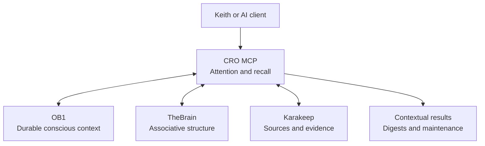
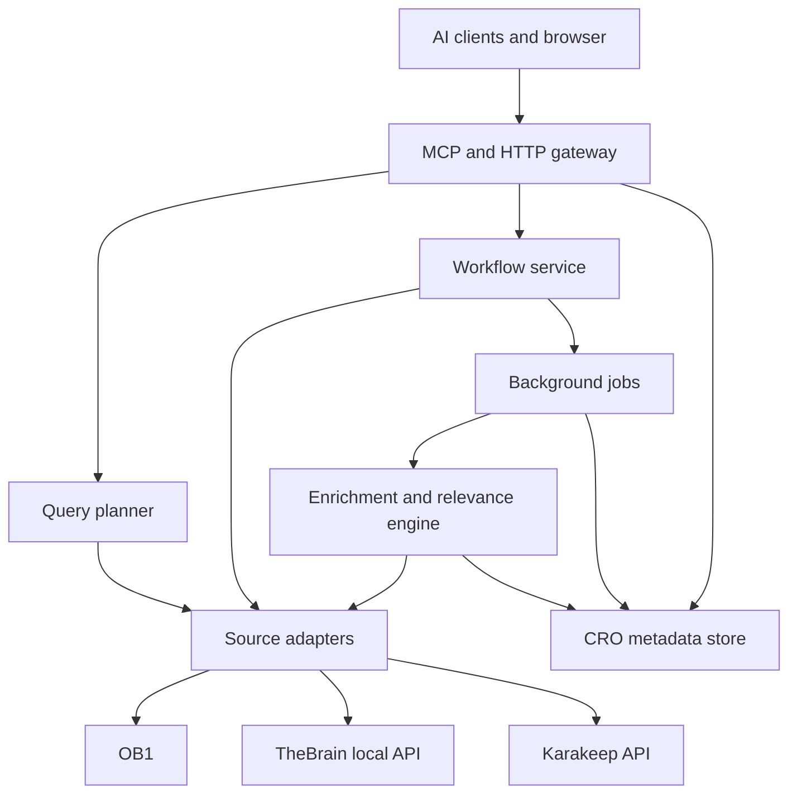
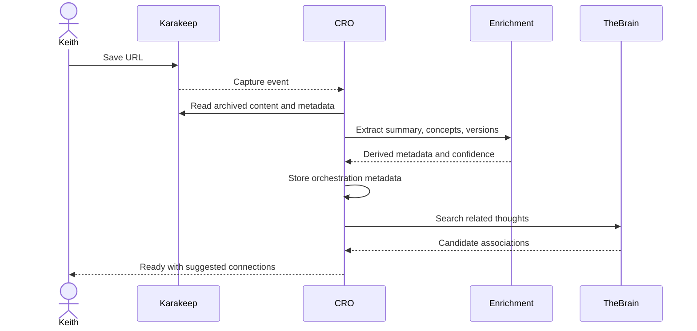
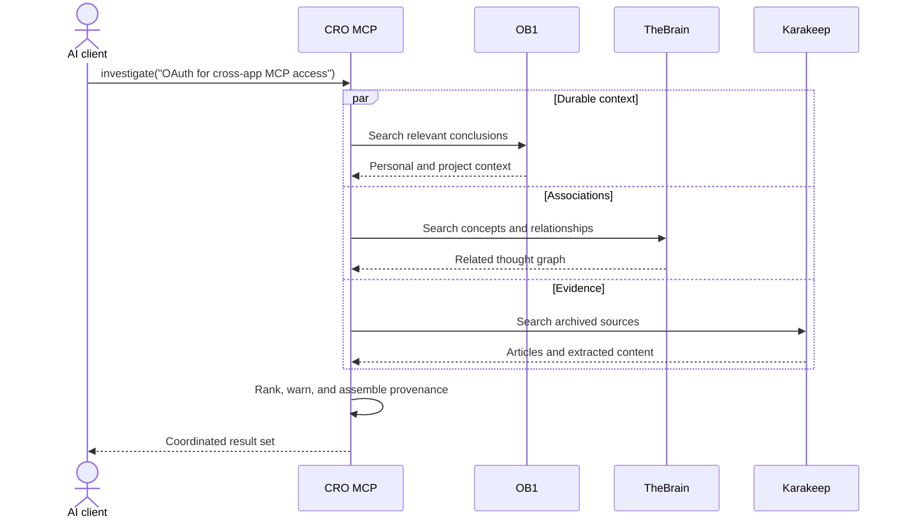
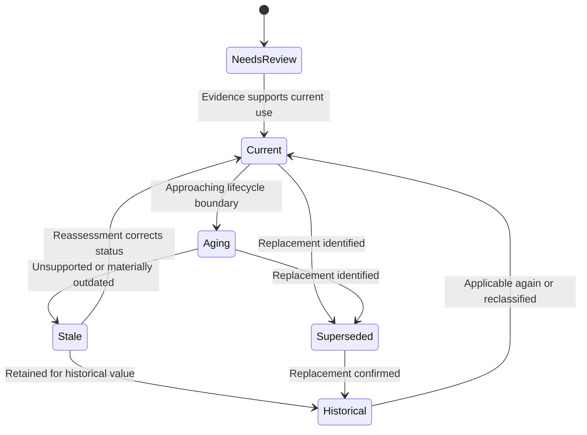

# Cognitive Research Orchestrator

## Technical Concept and System Architecture

**Status:** Concept architecture  
**Version:** 0.1  
**Date:** 2026-07-25  
**Working name:** Cognitive Research Orchestrator (CRO)  

> The working name is descriptive only. Product naming remains an open decision.

## 1. Executive Summary

The Cognitive Research Orchestrator is a local-first application that gives AI clients coordinated access to three distinct knowledge systems:

- **OB1** holds durable personal context: established preferences, conclusions, decisions, working principles, and identity-level knowledge.
- **TheBrain** holds associative structure: concepts, people, projects, technologies, and the relationships among them.
- **Karakeep** holds external source material: archived articles, documentation, papers, videos, highlights, and source metadata.

The application does not merge these systems into another generalized knowledge base. It provides an attention, retrieval, enrichment, and maintenance layer over them through a unified Model Context Protocol (MCP) server.

Its primary goals are to:

1. Make thousands of saved sources reliably retrievable.
2. Surface useful material without requiring the user to remember that it exists.
3. distinguish current guidance from stale, superseded, or historical material.
4. Preserve source provenance and system ownership.
5. Allow multiple AI applications to use the same personal research environment.
6. Connect sources, concepts, projects, and durable personal conclusions without copying everything everywhere.

## 2. Problem Statement

Traditional browser bookmarks fail at large scale because they preserve a URL while losing most of the context necessary for future use:

- Why the item mattered
- What it discussed
- Which project or interest it related to
- Whether it was ever read
- Whether its technical guidance is still current
- What newer source replaced it
- How it relates to other saved knowledge

A collection containing thousands of links becomes a write-only archive. Full-text search helps, but it still requires the user to formulate a query and remember enough about the missing item to search for it.

The desired system must support both:

- **Directed recall:** “Find the article about OAuth cross-application access in C#.”
- **Assisted recognition:** “I am designing MCP authentication; show me older material that may now matter.”

It must also recognize that a source can remain valuable while its implementation details become obsolete. A tutorial targeting .NET Core 3.1 may be stale as current implementation guidance but still useful as an explanation of MVC architecture or as historical evidence.

## 3. Cognitive Model

The architecture uses a cognitive metaphor to establish boundaries. The metaphor describes system responsibilities; it does not claim that the software reproduces human cognition.

| System | Cognitive role | Primary contents | Authority |
|---|---|---|---|
| OB1 | Conscious, durable context | Preferences, decisions, conclusions, behavioral rules, personal/project context | What Keith and collaborating AIs have concluded |
| TheBrain | Associative or preconscious network | Thoughts, concepts, people, projects, technologies, and explicit relationships | How ideas are organized and connected |
| Karakeep | Reference and recognition memory | Archived external sources, extracted text, highlights, notes, and capture metadata | What an external source actually contains |
| CRO MCP | Attention and recall | Federated search, context assembly, resurfacing, aging, and cross-system actions | What deserves attention for the present task |

The governing metaphor is:

> OB1 knows who I am and what I have concluded. TheBrain knows how everything might relate. Karakeep remembers what I encountered. The orchestrator decides what deserves attention now.

### 3.1 Conceptual Relationship



See [diagrams/01-cognitive-model.mmd](diagrams/01-cognitive-model.mmd).

## 4. Architectural Principles

### 4.1 Preserve distinct ownership

Every item has one canonical owner:

- Article content and archival snapshots belong to Karakeep.
- Conceptual relationships belong to TheBrain.
- Durable personal conclusions belong to OB1.
- Cross-system identifiers, processing history, and orchestration state belong to CRO.

### 4.2 Link rather than duplicate

TheBrain thoughts should link to Karakeep records rather than copy full articles. OB1 should contain a distilled conclusion only when one is genuinely durable, not an article summary merely because an article was saved.

### 4.3 Evidence before inference

AI-generated summaries, tags, version detection, and relevance assessments are derived metadata. They must remain distinguishable from:

- Original source content
- User-authored notes
- User-confirmed classifications
- Authoritative lifecycle information

### 4.4 No automatic destructive loss

The system may archive, demote, hide by default, mark stale, or mark superseded. It must not automatically delete source material, thoughts, or durable context.

### 4.5 Retrieval must include warnings

Stale or superseded material may still be retrieved, but the client must receive its relevance state, reason, confidence, and replacement references.

### 4.6 Human effort should remain small

Capture should require only the URL. One optional human sentence—“why this matters”—is more valuable than requiring extensive manual taxonomy.

### 4.7 Discovery should precede irreversible structure

Initial categories and scoring rules should remain deliberately simple. Usage evidence should drive later taxonomy and automation decisions.

## 5. System Context

### 5.1 External systems

#### Karakeep

Karakeep is the canonical source repository. It provides browser capture, content extraction, archival, tags, highlights, full-text search, semantic search, REST APIs, and webhooks.

Expected CRO usage:

- Create and retrieve bookmarks
- Obtain extracted article text and metadata
- Update tags and notes where supported
- Receive capture events through webhooks or polling
- Search source content
- Associate CRO relevance metadata with a Karakeep identifier

#### TheBrain

TheBrain is the canonical associative graph. TheBrain 15 provides a local API capable of creating and manipulating thoughts and supporting bulk restructuring.

Expected CRO usage:

- Search for thoughts
- Read thought metadata and relationships
- Create a source-related thought when policy permits
- Link concepts to projects, people, technologies, or other concepts
- Attach or record Karakeep references
- Navigate parents, children, jumps, types, and tags

The complete installed local API specification must be captured during technical discovery because the documentation is served from the local application.

#### OB1

OB1 remains the durable memory and context system.

Expected CRO usage:

- Search relevant memories by meaning
- Retrieve full durable context when needed
- Capture a new conclusion only through an explicit or policy-authorized action
- Avoid storing raw research articles or bulk source summaries

#### AI clients

Any MCP-compatible client may use CRO. Examples include ChatGPT, Codex, Claude, and development environments with MCP support.

Clients should not need direct knowledge of each underlying API. CRO provides a stable, task-oriented interface while retaining source attribution.

## 6. Logical Architecture



See [diagrams/02-logical-architecture.mmd](diagrams/02-logical-architecture.mmd).

### 6.1 MCP and HTTP gateway

Responsibilities:

- Expose task-oriented MCP tools
- Optionally expose a local administrative HTTP API
- Validate requests and permissions
- Normalize errors
- Attach provenance to every result
- Enforce write confirmation policies

### 6.2 Query planner

Responsibilities:

- Decide which systems are relevant to a request
- Rewrite a natural-language inquiry into system-specific queries
- Run independent reads concurrently
- Merge and rank heterogeneous results
- Deduplicate references without losing system identity
- Return an explanation of why each item was included

### 6.3 Workflow service

Responsibilities:

- Coordinate multi-step actions
- Process new captures
- Create suggested TheBrain associations
- Generate reading queues and digests
- Record user feedback
- Manage supersession and aging reviews

### 6.4 Source adapters

Each source adapter isolates the application from changes in an underlying API:

```text
IContextSource
  search(query, filters)
  get(id)
  health()
  capabilities()

IWritableContextSource
  create(payload)
  update(id, patch)
  link(sourceId, targetId, relationship)
```

Adapters must preserve native identifiers and expose declared capabilities. CRO must not assume that all systems support the same kinds of search, update, or relationship.

### 6.5 CRO metadata store

CRO needs a small canonical database for orchestration-specific state that belongs nowhere else:

- Cross-system identity mappings
- Relevance assessments and their history
- Technology/version observations
- Supersession links
- Processing checkpoints
- Resurfacing history
- User feedback
- Job state
- Audit events

PostgreSQL is the preferred production datastore. SQLite is acceptable for an initial single-user prototype if the data-access layer avoids database-specific behavior.

### 6.6 Background job service

Responsibilities:

- Enrichment after capture
- Periodic temporal review
- Source-health checks
- Re-indexing after metadata changes
- Scheduled digests
- Forgotten-gem resurfacing
- Retry of transient integration failures

Jobs must be idempotent and checkpointed.

### 6.7 Enrichment and relevance engine

Responsibilities:

- Extract technologies, products, versions, APIs, standards, people, and projects
- Produce summaries and concept tags
- Suggest TheBrain relationships
- Determine temporal relevance
- Find possible replacements
- Record evidence and confidence

AI output is advisory unless a policy explicitly permits automatic updates.

## 7. Canonical Data Model

### 7.1 Research resource

The research resource represents CRO’s reference to a canonical Karakeep item. It does not contain the canonical archived article.

```yaml
id: cro-resource-uuid
karakeep_id: native-karakeep-id
canonical_url: https://example.com/article
captured_at: 2026-07-25T12:00:00Z
processing_state: enriched
reading_state: inbox
personal_value: unreviewed
why_saved: null
```

### 7.2 Reading state

Only four initial human-controlled states are recommended:

| State | Meaning |
|---|---|
| `inbox` | Captured but not meaningfully reviewed |
| `read` | Meaningfully reviewed |
| `reference` | Intentionally retained for future retrieval |
| `discarded` | Noise, duplicate, or no longer wanted in normal results |

“Discarded” is a logical state, not physical deletion.

### 7.3 Temporal assessment

```yaml
resource_id: cro-resource-uuid
state: stale
assessed_at: 2026-07-25T12:30:00Z
assessor: cro-relevance-engine
confidence: 0.97
reason: >
  The tutorial targets ASP.NET Core 3.1, which is out of support.
technical_currency: stale
conceptual_value: high
historical_value: medium
review_after: 2026-10-25
evidence:
  - type: detected_version
    value: "ASP.NET Core 3.1"
  - type: authoritative_lifecycle
    source_url: https://dotnet.microsoft.com/platform/support/policy
```

### 7.4 Technology applicability

```yaml
resource_id: cro-resource-uuid
technology: dotnet
minimum_version: "3.0"
maximum_version: "3.1"
version_expression: ".NET Core 3.x"
detection_method: content_extraction
confidence: 0.99
```

Versions must be stored as domain-aware values. Generic lexical comparison is insufficient because ecosystems use different version and lifecycle conventions.

### 7.5 Supersession

```yaml
older_resource_id: cro-resource-old
newer_resource_id: cro-resource-new
relationship: implementation_replacement
reason: >
  The newer source explains the same task using supported .NET 10 APIs.
confidence: 0.91
confirmed_by_user: false
```

Supported relationships should include:

- `implementation_replacement`
- `official_replacement`
- `updated_edition`
- `conceptual_extension`
- `contradicts`
- `duplicates`

### 7.6 Cross-system link

```yaml
id: cro-link-uuid
left_system: thebrain
left_id: thought-native-id
right_system: karakeep
right_id: bookmark-native-id
relationship: supporting_source
created_by: user
created_at: 2026-07-25T13:00:00Z
```

## 8. Primary Flows

### 8.1 Capture and enrichment



See [diagrams/03-capture-flow.mmd](diagrams/03-capture-flow.mmd).

Default behavior:

1. The user saves a URL through Karakeep.
2. Karakeep archives and extracts the source.
3. CRO receives a webhook or detects the new item.
4. CRO extracts concepts, technologies, versions, and a short summary.
5. CRO searches TheBrain for related thoughts.
6. CRO records suggestions but does not automatically restructure TheBrain during the initial phase.
7. The item enters the `inbox` reading state.

### 8.2 Federated investigation



See [diagrams/04-federated-query.mmd](diagrams/04-federated-query.mmd).

The response must keep the layers visible:

- “OB1 indicates…” for durable context.
- “TheBrain connects…” for associative structure.
- “The source states…” for external evidence.
- “CRO infers…” for orchestration-layer analysis.

### 8.3 Temporal aging



See [diagrams/05-relevance-lifecycle.mmd](diagrams/05-relevance-lifecycle.mmd).

Age alone must not determine relevance. Assessment considers:

- Explicit technology and version references
- Official support lifecycle
- Deprecated APIs or practices
- Security guidance changes
- Existence of a newer equivalent source
- Conceptual and historical value
- User confirmation or correction

Recommended reassessment intervals:

| Domain | Default interval |
|---|---:|
| Security and authentication guidance | 30 days |
| AI tools, APIs, and fast-moving frameworks | 90 days |
| General software tutorials | 90 days |
| Hardware and product recommendations | 90 days |
| Medical, legal, and financial references | 30 days |
| Homesteading and agricultural techniques | 365 days |
| Writing craft and philosophy | 365 days or manual |
| Historical sources | No automatic review |

These defaults must be configurable by topic and source type.

### 8.4 Resurfacing

CRO supports several retrieval modes:

- **Contextual:** Relevant to the current conversation or project.
- **Reading queue:** Unread items balanced across active interests.
- **Forgotten gems:** High-value items not viewed recently.
- **Connection discovery:** Older sources related to a newly captured source.
- **Writing support:** Evidence relevant to an article under development.
- **Expiry review:** Old inbox items requiring retain, defer, or discard decisions.
- **Replacement review:** Stale sources for which a likely successor exists.

An initial candidate score may use:

```text
score =
    semantic_relevance
  + personal_value
  + project_relevance
  + novelty
  + time_since_last_surface
  + relationship_strength
  - prior_dismissals
  - stale_penalty_when_current_guidance_requested
```

The production formula should remain observable and configurable. A result must be able to answer, “Why was this shown?”

## 9. Proposed MCP Surface

### 9.1 Read-only tools

```text
search_sources(query, filters?, limit?)
get_source(source_id)
find_related_thoughts(query_or_source_id, depth?, limit?)
recall_context(query, limit?)
investigate(query, systems?, freshness?, limit?)
get_reading_queue(interests?, time_available?, limit?)
get_forgotten_gems(interests?, limit?)
explain_relevance(source_id)
find_replacements(source_id, limit?)
```

### 9.2 Mutating tools

```text
save_source(url, interest?, why_saved?)
set_reading_state(source_id, state)
add_source_note(source_id, note)
confirm_relevance(source_id, state, reason?)
link_source_to_thought(source_id, thought_id, relationship)
create_thought_from_source(source_id, parent_thought_id?, title?)
capture_conclusion(content, evidence_source_ids?)
dismiss_surfaced_item(source_id, reason?)
```

### 9.3 Administrative tools

```text
get_system_health()
get_source_capabilities()
run_relevance_review(scope?, dry_run?)
get_pending_suggestions(type?, limit?)
approve_suggestion(suggestion_id)
reject_suggestion(suggestion_id, reason?)
```

### 9.4 Mutation policy

Initial default:

| Action | Policy |
|---|---|
| Search and retrieval | Automatic |
| Derived CRO metadata | Automatic with audit trail |
| Update Karakeep tags | Suggest first |
| Create or restructure TheBrain thoughts | Explicit approval |
| Capture durable OB1 conclusion | Explicit approval |
| Delete from any underlying system | Never through initial MCP |

## 10. Relevance and Trust Model

Every derived assertion should contain:

- Assertion type
- Value
- Confidence
- Derivation method
- Supporting evidence
- Assessment time
- Next review time
- User-confirmation state

The system must distinguish:

```text
source_fact
authoritative_external_fact
user_statement
user_confirmed_classification
ai_extraction
ai_inference
```

For high-consequence topics such as health, law, finance, and security, current guidance should require authoritative external verification before CRO marks old material current.

## 11. Search and Ranking

### 11.1 Hybrid retrieval

The query planner should combine:

- Keyword/full-text matching
- Semantic similarity
- Explicit TheBrain graph distance
- OB1 personal/project relevance
- Source freshness and temporal state
- User-authored tags and notes
- Reading and resurfacing history

### 11.2 Result contract

Each coordinated result should include:

```yaml
title: Build a Secure C# MCP App with Cross App Access
canonical_system: karakeep
canonical_id: native-id
url: https://developer.okta.com/blog/2026/07/16/csharp-mcp-cross-app-access
relevance_state: current
relevance_reason: Targets current cross-app authorization practices.
matched_because:
  - Semantic match for OAuth and MCP
  - Linked to TheBrain thought "Cross-App Access"
  - Relevant to an active AI architecture inquiry
provenance:
  source_content: karakeep
  relationships: thebrain
  personal_context: ob1
```

### 11.3 Stale-result behavior

For current implementation queries, stale material should be demoted or excluded by default. If retrieved, it must carry a visible warning:

```text
Stale implementation: targets .NET Core 3.1.
Retained because the architectural explanation remains useful.
Newer related source: Building MVC Applications with .NET 10.
```

Historical, comparative, or migration queries should be able to request stale material explicitly.

## 12. Security and Privacy

### 12.1 Local-first boundary

TheBrain’s API is local to the desktop application. CRO should run locally or on a trusted host able to reach that local endpoint without exposing it directly to the public internet.

### 12.2 Authentication

The architecture should support:

- MCP-client authentication
- Per-client authorization policies
- Secure storage of Karakeep, TheBrain, OB1, and model-provider credentials
- Credential rotation
- No credentials in logs

### 12.3 Least privilege

Adapters should use separate credentials and the smallest available permissions. Read and write paths should be separable where underlying systems permit.

### 12.4 Prompt-injection resistance

Archived web pages are untrusted input. Source content must never be treated as system instructions. The enrichment service should:

- Delimit source content from control instructions
- Restrict available tools during extraction
- Validate structured outputs
- Reject instructions embedded in archived sources
- Require policy checks before cross-system writes

### 12.5 Auditability

Record:

- Client identity
- Tool invoked
- Systems accessed
- Records read or mutated
- Policy decision
- Before/after values for updates
- Derived metadata evidence
- Timestamp and correlation identifier

## 13. Deployment Concept

### 13.1 Initial single-user deployment

Recommended services:

```text
cro-gateway        MCP and optional HTTP API
cro-worker         Background jobs and enrichment
cro-database       PostgreSQL
karakeep           Existing source repository
karakeep-search    Karakeep-managed search service
```

TheBrain remains a desktop application with a local API. A local bridge may be required if CRO runs inside Docker or on another trusted machine.

OB1 remains independently deployed and is accessed through its existing interface.

### 13.2 Technology direction

The implementation language remains open. Selection should prioritize:

- Strong MCP SDK support
- Reliable background processing
- Typed API clients
- Structured-output validation
- Good observability
- Ease of local deployment

.NET is a natural candidate given the user’s background and interest, but it is not yet an established architecture decision.

## 14. Operational Requirements

### 14.1 Reliability

- Underlying system outages must degrade individual capabilities rather than fail all retrieval.
- Writes must use idempotency keys.
- Background jobs must retry transient failures with bounded backoff.
- Multi-system writes must report partial completion explicitly.
- CRO must not claim atomicity across independent systems.

### 14.2 Backup and recovery

Back up each canonical system independently:

- Karakeep database and archived assets
- TheBrain data through its supported backup/synchronization mechanism
- OB1 through its supported backup mechanism
- CRO PostgreSQL database and configuration

CRO mappings must be reconstructable where possible from native identifiers and embedded reference URLs.

### 14.3 Observability

Minimum operational signals:

- Adapter health
- Capture backlog
- Enrichment failures
- Relevance-review backlog
- Query latency by source
- Resurfacing acceptance/dismissal
- Orphaned cross-system links
- Authentication failures

## 15. Phased Delivery

### Phase 0 — Technical discovery

- Collect prior Claude design notes.
- Export or inspect the installed TheBrain local API specification.
- Inventory OB1 search, fetch, capture, tagging, and metadata behavior.
- Exercise Karakeep APIs against representative sources.
- Establish authentication and network boundaries.
- Confirm which metadata can safely live in Karakeep and what requires CRO storage.

**Exit criterion:** Verified capability matrix and resolved integration blockers.

### Phase 1 — Read-only federated retrieval

- Implement adapters.
- Expose `search_sources`, `find_related_thoughts`, `recall_context`, and `investigate`.
- Preserve provenance and relevance warnings.
- Add health reporting.

**Exit criterion:** One MCP client can answer a research question using all three systems without cross-system writes.

### Phase 2 — Capture enrichment

- Process new Karakeep records.
- Extract technologies, versions, concepts, and summaries.
- Store derived CRO metadata.
- Suggest TheBrain connections.

**Exit criterion:** Newly saved articles become searchable with useful derived metadata and association suggestions.

### Phase 3 — Temporal relevance

- Implement lifecycle-source adapters.
- Add relevance states, assessments, and history.
- Detect likely supersession.
- Warn or demote stale implementation material.

**Exit criterion:** A .NET 3.x tutorial is distinguished from current .NET guidance without being deleted.

### Phase 4 — Resurfacing

- Add reading queues, forgotten gems, contextual resurfacing, and expiry review.
- Record impressions, acceptance, dismissal, and suppression.
- Tune scoring from observed behavior.

**Exit criterion:** The system reliably presents useful forgotten material without repetitive noise.

### Phase 5 — Controlled cross-system writes

- Add approval queues.
- Create confirmed TheBrain links and thoughts.
- Capture explicitly approved durable conclusions into OB1.
- Add reversible metadata updates where supported.

**Exit criterion:** Approved writes preserve canonical ownership, provenance, and audit history.

## 16. Open Design Questions

### Product

- What is the final application name?
- Is a dedicated visual UI required, or are MCP clients plus an administrative dashboard sufficient?
- Should the first release support one person only by design?

### Integration

- What exact operations and event mechanisms does the installed TheBrain local API expose?
- Can Karakeep store all visible temporal metadata, or should it show only a concise status tag linked to CRO details?
- What OB1 metadata and tagging operations are available without compromising its engram model?
- How should local TheBrain access work when CRO runs in Docker?

### Information policy

- Which TheBrain links may be created automatically?
- What threshold changes an association from a suggestion to an accepted relationship?
- What qualifies a conclusion for OB1 capture?
- Should user-authored “why saved” text ever be rewritten?

### Relevance

- Which authoritative lifecycle sources should be supported first?
- How should evergreen conceptual value be scored separately from implementation currency?
- When should contradictory sources be surfaced together?
- How much evidence is required before assigning `superseded`?

### Operations

- Which AI provider should perform enrichment?
- Is local inference required, preferred, or optional?
- What are acceptable latency and cost targets?
- What backup and recovery objectives are required?

## 17. Established Decisions vs Proposals

### Established in the concept

- OB1, TheBrain, and Karakeep remain separate canonical systems.
- Articles are not stored in OB1.
- Karakeep owns archived source material.
- TheBrain provides associative structure.
- OB1 provides durable personal context and conclusions.
- CRO provides unified MCP access, attention, retrieval, aging, and resurfacing.
- Material is aged and flagged rather than automatically deleted.
- Stale implementation value is distinct from conceptual or historical value.
- Provenance must remain visible.

### Proposed and subject to validation

- PostgreSQL as the CRO metadata database
- A gateway/worker service split
- Exact MCP tool names
- Default reassessment intervals
- Initial scoring formula
- Approval requirements for individual write types
- .NET as a possible implementation language

## 18. Success Criteria

The application succeeds when:

1. A newly saved source is archived, enriched, and retrievable without manual filing.
2. An AI client can combine personal context, associative relationships, and external evidence while identifying each source.
3. The system can surface a forgotten relevant article during unrelated future work.
4. Obsolete technical guidance is clearly flagged and demoted without being destroyed.
5. A user can understand why an item appeared and correct the system.
6. Cross-system writes are deliberate, attributable, and auditable.
7. Thousands of sources remain navigable without a deep manually maintained folder hierarchy.

## 19. Reference Sources

- [Karakeep product overview](https://karakeep.app/)
- [Karakeep documentation](https://docs.karakeep.app/)
- [Karakeep AI provider configuration](https://docs.karakeep.app/configuration/different-ai-providers/)
- [TheBrain local API announcement](https://thebrain.com/blog/thebrain-api-local)
- [TheBrain 15 overview](https://thebrain.com/products/thebrain/thebrain15)
- [Okta: Build a Secure C# MCP App with Cross App Access](https://developer.okta.com/blog/2026/07/16/csharp-mcp-cross-app-access)

