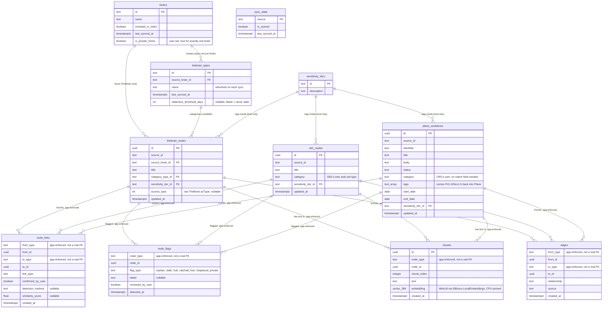

# cro_index schema

Draft, settled table-by-table through live verification against the
real TheBrain local API and the real OB1 instance (2026-11-03). Replaces
the earlier reference to a `project_cro_index_schema_draft.md` session
file, which was never actually saved anywhere.

## Why one table per source, not a single shared table

An earlier draft used a single `nodes` table with a `source` column
distinguishing `'thebrain'` vs `'ob1'` rows. Dropped: that assumes a
1:1 identity between a TheBrain Thought and an OB1 thought, which
isn't true. A single OB1 thought can correspond to zero or more
TheBrain Thoughts (and now Plane work items), and vice versa.
Source-specific tables (`thebrain_nodes`, `ob1_nodes`,
`plane_workitems`) plus one generic `node_links` table model that
honestly.

## brains

Parent table to `thebrain_nodes` only — OB1 has no brain concept.
Same resync concern as `thebrain_types` below: the list of brains
itself can grow (confirmed live going from an initial assumption of
one or two to 8 real brains during this planning), so `last_synced_at`
was added 2026-11-04 to track it, not just populate it once.

| Column | Type | Notes |
|---|---|---|
| `id` | text | TheBrain's own GUID |
| `name` | text | e.g. "Growth", "Filing Cabinet" |
| `included_in_index` | boolean | `false` for `CRO API Discovery 2026-10-11` and `Blue Skies Unlimited` (scratch/discovery brains); `true` for Growth, Filing Cabinet, Future Life, SW Architecture, MVP 2013, Lifestyle Defined. This is a `cro_index` indexing-scope toggle only — it does not touch TheBrain itself. |
| `last_synced_at` | timestamptz | when this row was last refreshed against TheBrain's live `/brains` list |
| `is_private_home` | boolean, default `false` | **Added 2026-11-05.** User-set, not auto-derived — true for exactly one brain (Filing Cabinet, confirmed live as the user's intended home for private content). Drives `node_flags.flag_type = 'misplaced_private'` (see `thebrain_nodes.access_type` and `node_flags` below): a Private Thought outside this brain is flag-worthy, one inside it isn't. |

## thebrain_types

Parent table to `thebrain_nodes.category_type_id`. Added 2026-11-04
after a direct warning: TheBrain's Types are themselves regular,
user-editable Thoughts — freeform, not a fixed enum. Confirmed live
against a real endpoint (`/thoughts/{brainId}/types`, brain-scoped,
same as Thoughts themselves): 8 real Types exist in Growth right now
(Audio, Books, CLOSED, Personal Growth (The Process), Projects,
Purpose, Success Example, Timeline). This table is what gets
re-synced — individual `thebrain_nodes` rows just hold a stable FK.

| Column | Type | Notes |
|---|---|---|
| `id` | text | TheBrain's Type-Thought GUID |
| `source_brain_id` | text, FK → `brains.id` | Types are per-brain, confirmed live by the brain-scoped endpoint |
| `name` | text | refreshed on each sync — never treated as permanent |
| `last_synced_at` | timestamptz | when this row was last refreshed against TheBrain's live Types list |
| `staleness_threshold_days` | int, nullable | **Added 2026-11-04 (Epic 1 "stale" flag design).** Blank by default — a Type never goes stale until this is explicitly set. Settled live against the user's own Growth brain: Medical/Financial-style content stays blank forever (history, not decay); Software was set to 180 days. A `thebrain_nodes` row with **no Type at all** (`category_type_id` null) is also exempt — most Thoughts currently have no Type, so this also prevents a first-run "everything is stale" flood on a brain that's years old. |

**Cross-phase concern, not just a schema note (per the user's own
framing, 2026-11-04):** resyncing `brains` and `thebrain_types` against
TheBrain's live state needs to be a standing startup step, run before
*any* phase that touches TheBrain — Phase 1's bootstrap, Phase 3's
ongoing create/update, and Phase 4's reorg all depend on these two
tables being current, not just populated once. Not yet placed as an
explicit task in any phase doc — see `docs/phase-roadmap.md`'s
cross-cutting section, which needs this added.

## sensitivity_tiers

Lookup table, referenced by both node tables, so the tier values live
in one place instead of being repeated free text.

| Column | Type | Notes |
|---|---|---|
| `id` | text, PK | `'standard'`, `'personal'`, `'restricted'` |
| `description` | text | Tier reflects how private the *content* is, never just whether a specific person is named. Correction (2026-11-03): the real "Who Am I" Thought's note mentions "my wife, Kittery," but naming her is not itself sensitive — that note is `standard`. `restricted` = actual medical diagnosis/records content, confirmed live to live in the Filing Cabinet brain — never returned without explicit override (see CURRENT.md's non-negotiables). `personal` is reserved for content that's genuinely private but not restricted-grade (exact bar still to define). Whose fact something is (attribution) is a separate question from how private it is — see "Still to settle." |

## thebrain_nodes

| Column | Type | Notes |
|---|---|---|
| `id` | uuid | ours |
| `source_id` | text | TheBrain's Thought GUID |
| `source_brain_id` | text, FK → `brains.id` | which brain it's in — required because TheBrain's API is brain-scoped (`/thoughts/{brainId}/{thoughtId}`), confirmed live |
| `title` | text | TheBrain's real `name` field — confirmed live to be a clean, author-written title, unlike OB1's |
| `category_type_id` | text, FK → `thebrain_types.id`, nullable | **Corrected 2026-11-04 — was a frozen `category` text column, now a live FK.** TheBrain's Types are themselves regular, user-editable Thoughts (confirmed live: 8 exist in Growth right now, via `/thoughts/{brainId}/types`) — freeform, can be renamed, added, or removed at any time. Storing a resolved name as plain text would go stale the moment that happens. The FK points at `thebrain_types`, which is the thing that gets re-synced, not every node that references it. `null` means no type set (confirmed live on "Who Am I"). |
| `sensitivity_tier_id` | text, FK → `sensitivity_tiers.id`, default `'standard'` | **Corrected 2026-11-05 — "TheBrain has none" was wrong.** TheBrain does have a native signal (`access_type`, below) — it's just unreliable on its own, confirmed live: under "Health Records," the sibling "Surgeries" is marked Private while clearly-medical "EDS" and "Research Info" are not. `access_type = 1` is an **input signal** CRO weighs when classifying, never a blind copy — CRO's own judgment still has to catch what the user's manual marking missed. |
| `access_type` | int, nullable | **Added 2026-11-05.** TheBrain's own `acType` field, raw — `0` confirmed live as normal, `1` confirmed live as the UI's "Private" marker (undocumented by the API itself; found by direct observation on "Val Docs" and its children, all `acType=1`). Other values unconfirmed, stored as-is rather than assumed. Drives both `sensitivity_tier_id` classification above and `node_flags.flag_type = 'misplaced_private'` below. |
| `updated_at` | timestamptz | TheBrain's `modificationDateTime` |

## ob1_nodes

| Column | Type | Notes |
|---|---|---|
| `id` | uuid | ours |
| `source_id` | text | OB1's thought uuid — confirmed live, a real stable id |
| `title` | text | OB1's title field is auto-generated (date + truncated body text), confirmed live — not a clean title the way TheBrain's `name` is |
| `category` | text | OB1's own auto-set `metadata.type` — confirmed live: `observation`, `task`, `reference`, `idea`, `person_note`. Copied straight from the source, unlike `sensitivity_tier_id` below. |
| `sensitivity_tier_id` | text, FK → `sensitivity_tiers.id`, default `'standard'` | same rule as `thebrain_nodes` — OB1 has no native sensitivity field either |
| `updated_at` | timestamptz | OB1's `metadata.updated_at`, confirmed live distinct from `created_at` |

## plane_workitems

Third node table, added 2026-11-03 once Plane joined TheBrain and OB1
as a data store going forward. Columns confirmed live against a real
Plane work item (a different workspace than the one that will
actually host the CRO project — that's a fresh, blank Plane install,
per the user — but the API shape is identical either way).

**`category` exists here too, same mechanism as `sensitivity_tier_id`
— corrected 2026-11-04.** `sensitivity_tier_id` was never native-
sourced on *any* of the three node tables; it's always CRO's own
classification. `category` works the same way on `plane_workitems`:
`cro_index` can assign it without Plane itself needing a matching
field. Not a real asymmetry after all — this workspace's plan tier
blocking custom properties (confirmed live — the tool call errored)
only matters for what Plane itself can store, not for what
`cro_index` stores about a Plane work item.

**Priority and severity are different: they're meant to be visible
inside Plane itself, not just in `cro_index`.** Since this workspace
can't do custom fields, CRO writes them into Plane's own `tags`
instead, using `Pri1`–`Pri5` and `Sev1`–`Sev5` (1 = highest, 5 =
lowest, user's convention 2026-11-04) — a tag round-trips into Plane's
UI the way a `cro_index`-only column never would.

| Column | Type | Notes |
|---|---|---|
| `id` | uuid | ours |
| `source_id` | text | Plane's work item uuid |
| `identifier` | text | e.g. "CRO-3" — human-readable |
| `title` | text | Plane's `name` |
| `body` | text | Plane's `description_stripped` — plain text, better for chunking than `description_html` |
| `status` | text | the state's name — kept as plain text, not a lookup table, since this is one project with a small status list |
| `category` | text | CRO's own classification, same as `thebrain_nodes`/`ob1_nodes` — no native Plane field backs it, same as `sensitivity_tier_id` below never has one either |
| `tags` | text[] | Plane's labels — a simple array, not a separate labels table. Also where CRO writes priority (`Pri1`–`Pri5`) and severity (`Sev1`–`Sev5`) back into Plane itself, since there's no native field for either here |
| `start_date` | date, nullable | confirmed live: Plane allows null |
| `end_date` | date, nullable | Plane's `target_date` |
| `sensitivity_tier_id` | text, FK → `sensitivity_tiers.id`, default `'standard'` | same rule as the other two node tables |
| `updated_at` | timestamptz | Plane's own `updated_at` |

## node_links

Replaces the earlier `node_links` (TheBrain↔OB1 only) and
`thebrain_node_links` (TheBrain↔TheBrain) drafts — one generic table
now, since a third source (Plane) made growing a separate pairwise
table per combination unworkable. Handles any combination: TheBrain↔
OB1, TheBrain↔Plane, OB1↔Plane, and same-type links (TheBrain↔
TheBrain, for the cross-brain-duplicate case) all in one table.
`from_type`/`to_type` plus `from_id`/`to_id` identify which node table
each side's id belongs to — Postgres can't enforce a polymorphic FK
directly, so this pairing is an app-level rule CRO must honor when
writing, not something the database itself checks.

| Column | Type | Notes |
|---|---|---|
| `from_type` | text | `'thebrain'` \| `'ob1'` \| `'plane'` |
| `from_id` | uuid | id in the matching node table (`thebrain_nodes`, `ob1_nodes`, or `plane_workitems`) |
| `to_type` | text | same three values |
| `to_id` | uuid | same rule |
| `link_type` | text | `'reference'` (general cross-reference, e.g. a Plane work item pointing at a TheBrain thought) \| `'duplicate_candidate'` (CRO-detected, e.g. same title in two brains) \| `'confirmed_same_entity'` (user confirmed) \| `'native'` (a real TheBrain cross-brain link, if one is ever found in active use) |
| `confirmed_by_user` | boolean, default `false` | distinguishes an automatic CRO guess from something the user has actually verified |
| `detection_method` | text, nullable | **Added 2026-11-04, extended 2026-11-05.** `'title_match'` \| `'embedding_similarity'` \| `'note_brain_link'` \| `'user_manual'`. Null for a link that isn't a detection result at all. `'note_brain_link'` pairs only with `link_type = 'native'`: a real TheBrain cross-brain link, found 2026-11-05 — confirmed live on "Health Records" (Growth), whose Note body contains a `brain://` URI resolving to "Health History" in Filing Cabinet. **This kind of link lives inside Note Markdown text, not in the `/graph` response at all** (`jumps` was empty for that same Thought) — it can only be found by scanning Note bodies for `brain://` URIs and decoding their base64url-encoded brain/Thought GUIDs, a separate pass from the `edges` walk below. |
| `similarity_score` | float, nullable | **Added 2026-11-04.** The embedding cosine similarity that produced an `'embedding_similarity'`-detected row — in particular the duplicate-neighborhood-expansion check (below). Null when `detection_method` isn't `'embedding_similarity'`. |
| `created_at` | timestamptz | |

**Invariant to enforce at write time (not a DB constraint), corrected
2026-11-05:** every `thebrain_nodes` and `plane_workitems` row must
have at least one `node_links` row to an `ob1_nodes` row (OB1
universal coverage, DECISIONS 2026-10-18). The reverse does NOT hold:
an `ob1_nodes` row may have zero links. OB1 deliberately holds some
business-process information that exists nowhere else (user,
2026-11-05), so OB1-only thoughts are normal, not errors. This
replaces the earlier rule "an OB1 entry never stands alone".

## node_flags

**Added 2026-11-04 (Epic 1 orphan/stale/hub design).** `node_links`
only models relationships *between two* nodes — orphan, stale, and hub
are properties of *one* node, so they don't fit there. Same
polymorphic `type`/`id` pairing as `node_links`, and the same
`confirmed_by_user`-style review pattern, renamed for this context.

| Column | Type | Notes |
|---|---|---|
| `node_type` | text | `'thebrain'` \| `'ob1'` \| `'plane'` |
| `node_id` | uuid | id in the matching node table |
| `flag_type` | text | `'orphan'` (zero rows in `node_links` and `edges`, either side) \| `'stale'` (older than its Type's `staleness_threshold_days`; never set if the Type's threshold is blank or the node has no Type) \| `'hub'` (30+ total links/edges on a non-Type node — Type Thoughts, `kind=2`, are never flagged regardless of size, confirmed live against "Rolodex": 100+ children, and "Timeline" — both are Types, not regular Thoughts; confirmed live against two regular, non-Type Thoughts — "Quiver Software Development" at 24 links and "Technologist & ASPInsider" at 15 — that the 30 threshold doesn't over-flag ordinary well-connected content) \| `'catchall_hub'` (deferred — see below) \| `'misplaced_private'` (TheBrain nodes only — `access_type = 1` on a node whose `source_brain_id` isn't the one `brains` row with `is_private_home = true`; confirmed live on "Val Docs" and its 5 children, all `access_type=1`, all in Growth rather than Filing Cabinet) |
| `detail` | text, nullable | why — e.g. `"42 links"`, `"stale 210d vs Type's 180d threshold"` |
| `reviewed_by_user` | boolean, default `false` | same pattern as `node_links.confirmed_by_user` — Epic 4 review tracking |
| `detected_at` | timestamptz | |

**`'catchall_hub'` is a deferred, second-pass flag type (2026-11-04),
not part of Epic 1's first bootstrap run.** Instead of counting links,
it walks a node's neighbors up to 3 jumps out (via `edges`/
`node_links`) and compares their `chunks.embedding` values — if the
neighbors share no real semantic theme, the node is a "catch-all"
rather than a coherent hub (confirmed live: "Rolodex"'s 100+ children
are all people, so it would pass a coherence check even though it
fails the flat link-count one; a true catch-all would fail both). The
similarity cutoff for "no real theme" can't be picked by reasoning
alone — it needs tuning against real embeddings, which don't exist
until after the first bootstrap populates `chunks`. This flag type is
therefore designed to be **run as its own pass after Epic 1's raw read
completes**, re-run as needed, not computed inline during the bootstrap
read itself. See `docs/phase-1-plan.md`'s Features section.

**Duplicate-neighborhood expansion (2026-11-04) reuses `node_links`,
not `node_flags`.** Once a `duplicate_candidate` pair exists (the
"Kittery" case), their neighbors (parent/child/jump, same nodes
`edges` already tracks) are compared pairwise by embedding — a high-
similarity neighbor pair gets its own `node_links` row, `link_type =
'duplicate_candidate'`, `detection_method = 'embedding_similarity'`,
with the triggering score in `similarity_score`. Same deferred-pass
reasoning as `'catchall_hub'`: needs real embeddings to tune against,
so it runs after Epic 1's raw read, not during it.

## chunks

The actual text content, split for embedding/search — see
`CURRENT.md`'s chunking primer for why this exists separately from the
node tables. Uses the same polymorphic `type`/`id` pairing as
`node_links`, so one `chunks` table covers all three node tables
instead of three separate chunk tables.

| Column | Type | Notes |
|---|---|---|
| `id` | uuid | ours |
| `node_type` | text | `'thebrain'` \| `'ob1'` \| `'plane'` |
| `node_id` | uuid | id in the matching node table |
| `chunk_index` | integer | position within the node's text (0-based) |
| `text` | text | the chunk's raw text |
| `embedding` | vector(384) | **Settled 2026-11-04.** `ElBruno.LocalEmbeddings` (NuGet), default `sentence-transformers/all-MiniLM-L6-v2` model via ONNX Runtime, 384 dimensions. Runs in-process inside CRO itself — no separate server, no network call, nothing leaves the laptop. Built on `Microsoft.Extensions.AI`'s `IEmbeddingGenerator` abstraction, which is interfaces only and contains no model or compute itself. **Kept on the CPU execution provider** — not because either GPU is forbidden (the base's GTX 1660 Ti is allowed, if explicitly pinned there — see `CURRENT.md`'s non-negotiables), but because a model this small (~22-87MB depending on precision) gains nothing from one. The tablet half's integrated GPU stays off-limits regardless, per the user's actual Surface Book 2 history. Upgrade path if quality ever falls short: the same package's EmbeddingGemma variant (768-dim) — if that ever genuinely needs GPU acceleration, it must be pinned to the base's dGPU explicitly, never left on a default. |
| `created_at` | timestamptz | |

**No `sensitivity_tier_id` on `chunks` — corrected 2026-11-04.**
Sensitivity lives on the node (thought/work item) only, matching how
OB1 itself classifies: its `category` field (added to `ob1_nodes`
above) is set once per thought, not per paragraph. A chunk inherits
its tier by joining back to its node; it never carries its own.

**Chunk-splitting rule (settled 2026-11-04):** split on logical
blocks first — Markdown heading boundaries, confirmed live as a real,
natural split point in the "Who Am I" example (9 headings, 6
meaningful sections). Within a block:
- If the block is **under the ceiling, it's one chunk.**
- If a block **exceeds the ceiling**, split it further — by paragraph
  break, then by sentence if a single paragraph is still too long.
- If a thought/note has **no logical blocks at all** (no headings, no
  Note body) — confirmed live as a real case (the Flipboard bookmark
  thought) — fall back to one chunk made from the title alone.

**The ceiling itself (settled 2026-11-04):** the real limit is
**256 WordPiece tokens** — a hard model limit for `all-MiniLM-L6-v2`,
not an estimate. Two things confirmed from the model's own
documentation that make this one worth getting right, not rounding
loosely:
- The model's tokenizer config file says 512, but the model itself
  truncates at 256 and was never trained past that — trusting the 512
  figure would silently lose the back half of some chunks.
- Quality degrades even approaching 256, not just past it — the model
  "has not been trained to perform on sequences that exceed 256
  tokens." This isn't just a cutoff; it's a reason to split well
  *before* hitting the limit, not right up against it.

**Character estimate vs. the real check — don't conflate them.**
~1000 characters is a reasonable *planning* estimate (≈4 characters
per WordPiece token for English text), useful for a first pass at
where to split cheaply. The **actual enforcement must count real
tokens from the same tokenizer the model uses**, not characters —
the ratio varies by text (punctuation-heavy or jargon-heavy text
tokenizes differently than plain prose), so a character count alone
can both over- and under-estimate the true token count.

## edges

The cached graph-relationship table — a fast local copy of
relationships that already exist in TheBrain (parent/child/jump) or
OB1 (shared people/topics), so a search's "serendipity" hop doesn't
need a live round-trip per hop. Same polymorphic pairing as
`node_links`, but `edges` is about a source's own native graph
structure; `node_links` is about cross-source (or cross-brain)
identity/reference. Different purpose, same shape.

| Column | Type | Notes |
|---|---|---|
| `from_type` | text | `'thebrain'` \| `'ob1'` \| `'plane'` |
| `from_id` | uuid | id in the matching node table |
| `to_type` | text | same three values |
| `to_id` | uuid | same rule |
| `relationship` | text | e.g. `'parent'` \| `'child'` \| `'jump'` (TheBrain-native) or `'shared_topic'` \| `'shared_person'` (OB1-native) — source-dependent, not a fixed enum across sources |
| `source` | text | which system's native relationship this mirrors — `'thebrain'` \| `'ob1'` |
| `created_at` | timestamptz | |

**No separate column for *which* topic/person two OB1 nodes
share — resolved 2026-11-04, user's own observation.** Storing the
specific shared value on the edge row would just duplicate something
derivable: re-read either linked node live (already required before
answering, per the acceptance tests) and the shared topic/person is
whatever's common between their `topics`/`people` lists. Matches the
existing "disposable index" rule — don't store what can be derived.

**Settled 2026-11-04: `edges` (and `chunks`) are populated during
Phase 1's bootstrap, not deferred to Phase 2.** `edges` rows come from
walking each Thought's `/graph` response (confirmed live that the
endpoint exists and returns parents/children/jumps) during the same
bootstrap pass that populates `thebrain_nodes`/`ob1_nodes`. Phase 2
only *searches* what Phase 1 already populated — it doesn't populate
anything itself. This resolves the earlier contradiction between
acceptance test 0 (which needs content "findable through `cro_index`")
and the old schema list that left `chunks`/`edges` out of Phase 1
entirely.

## sync_state

Bootstrap/rebuild tracking. Settled 2026-11-04 — a status record, one
row per source, not a duplicate-prevention mechanism by itself.

| Column | Type | Notes |
|---|---|---|
| `source` | text, PK | `'thebrain'` \| `'ob1'` \| `'plane'` |
| `is_synced` | boolean, default `false` | whether this source has ever completed a full bootstrap pass |
| `last_synced_at` | timestamptz, nullable | null until the first successful sync |

**What this table does and doesn't guarantee.** It answers "has this
source been synced, and when" — useful for operational visibility
(has Phase 1 actually run? when?). It does **not**, by itself, prevent
duplicate rows on a second run (Phase 1 acceptance test 3). That
protection has to come from the bootstrap code itself doing an
upsert-by-`source_id` against `thebrain_nodes`/`ob1_nodes`/
`plane_workitems` — if a row for that `source_id` already exists,
update it; never blindly insert. `sync_state` and the upsert logic are
two different mechanisms serving two different purposes; this table
alone would not make test 3 pass.

**Coarser than `brains`/`thebrain_types`' own tracking, deliberately.**
Those two tables already have their own `last_synced_at` per brain/
per type (added earlier for the same freeform-growth reason). This
table tracks the bootstrap pass as a whole, per source — a different,
coarser granularity, not a duplicate of that tracking.

## Still to settle

- How `node_links` rows get created for the general `'reference'` case
  (manual, graph-edge inference) — still open. The `'duplicate_candidate'`
  case is now settled: title match for the direct case (e.g. two
  "Kittery" Thoughts), embedding similarity for the deferred
  neighbor-expansion case — see `node_flags` and the
  `node_links.detection_method`/`similarity_score` columns above. CRO
  never auto-merges either way — this only ever creates a flagged
  candidate for the user to confirm.
- **The restructure-flow UX** (CRO asking "should this be moved to
  Filing Cabinet?", surfacing "this thought exists in 2 brains") —
  named 2026-11-04 as Phase 4 scope (acting on flags Phase 1 raised).
  Not yet designed.
- **The actual move-between-brains mechanism** — Phase 4 scope.
  TheBrain's API supports creating/deleting Thoughts and Notes; moving
  one between brains likely means recreate-in-target plus delete-
  from-source. Unverified against the live API that this round-trips
  without data loss, including attachments.
- **Attribution vs. sensitivity are two separate questions, not one.**
  Sensitivity (`sensitivity_tier_id`) is how private the content is.
  Attribution — whose fact this specifically is (e.g. this is
  Kittery's diagnosis, not Keith's) — is a different axis, not yet
  modeled anywhere in this schema. Needed before `restricted` can be
  applied correctly to Filing Cabinet content; not needed for the
  `standard` "Who Am I" case.

## Full schema diagram

Canonical copy: `docs/architecture/09-cro-index-schema.mmd`, matching
the numbered convention every other architecture diagram in this repo
uses. The copy below is kept in sync by hand — if the two ever
disagree, the `.mmd` file is the source of truth.

`node_links`, `chunks`, and `edges` each reference "one of three
tables" via a `type`/`id` pair, not a real foreign key — Mermaid has
no notation for that, so each is drawn with a relationship line to all
three node tables, labeled as app-enforced, not database-enforced.
`sync_state` has no FK relationships to draw — its `source` column is
a plain string tag, not a reference to any other table.

