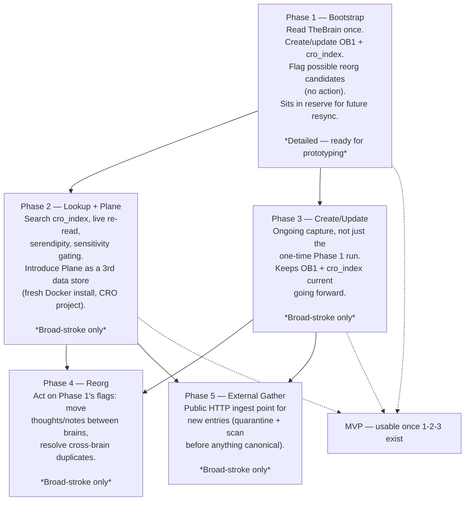

# CRO Phase Roadmap

Broad-stroke overview of all planned phases. Phase 1 is the only one
detailed enough to move toward physical architecture, prototyping, or
an MVP build — Phases 2–5 are named and scoped at the 50,000-foot
level only (2026-11-04) and each needs its own detailed planning pass,
the same way Phase 1 got one (live field verification against the
real TheBrain/OB1/Plane APIs, a real schema, real acceptance tests)
before it's buildable.

Phases 1–3 together are the usable MVP. Phases 4–5 extend it.

## Diagram

## Phase summary

| Phase | Name | Scope, one line | Status |
|---|---|---|---|
| 1 | Bootstrap | One-time: read TheBrain, write OB1 + `cro_index`, flag reorg candidates | **Detailed — `docs/phase-1-plan.md`, awaiting approval** |
| 2 | Lookup + Plane | Search capability; Plane joins as a 3rd data store | Broad-stroke — `docs/phase-2-plan.md` |
| 3 | Create/Update | Ongoing capture (not one-time) | Broad-stroke — `docs/phase-3-plan.md` |
| 4 | Reorg | Act on Phase 1's flags — move/merge for real | Broad-stroke — `docs/phase-4-plan.md` |
| 5 | External Gather | Public HTTP ingest point for new entries | Broad-stroke — `docs/phase-5-plan.md` |

## Cross-cutting decisions (apply to every phase, not just one)

### Implementation language and dependencies

**C# / .NET**, chosen over the earlier draft TypeScript recommendation
— the user is a C# developer and can actually review this code over
the years it will run. None of OB1's own source is reused directly
(CRO only talks to it as a REST client), so matching OB1's
implementation language was a convenience argument, not a real
requirement.

- **Hosting:** Kestrel (ASP.NET Core's native host) — not OWIN, the
  older, largely superseded .NET hosting standard.
- **Endpoints:** minimal API handlers, no MVC controllers.
- **Organization:** vertical slice architecture — code grouped by
  feature (endpoint + request + handler + validation together), not
  by technical layer. Tight coupling inside a slice is expected; low
  coupling between slices. Shared cross-cutting concerns (logging,
  auth, validation) go into endpoint filters/middleware, not a shared
  service layer that re-couples everything.
- **CQRS/mediator band:** both **MediatR** and **Mediator** kept open
  as options, decided per-slice as the app is built — not locked in
  now.
  - `MediatR` went commercial at v13 (dual-licensed; free community
    tier for personal/small use under $5M revenue) — fine for this
    project's scale, but a known constraint, not a silent surprise.
  - `Mediator` is the MIT-licensed, source-generator-based,
    AOT-friendly alternative with a near-identical API — the safer
    default if licensing terms ever matter.
  - CQRS/Event Sourcing may be used where it genuinely fits (e.g., the
    `cro_index` rebuild-from-source flow has an event-sourced flavor
    already, per the "disposable index" rule) — not mandated
    project-wide.
- **Validation:** FluentValidation.
- **Logging/instrumentation:** Serilog, sinking to the **already-
  running local Seq container** (`weatherstation-seq`,
  `datalust/seq:latest`, ports 5341/8080) — either shared with the
  existing weather-station project's logs or a second dedicated Seq
  instance if the user prefers not to mix them.
- **Data access:** Npgsql for Postgres + pgvector.
- **Local embeddings (settled 2026-11-04, refined 2026-11-04):**
  `ElBruno.LocalEmbeddings` (NuGet), default `all-MiniLM-L6-v2` model
  via ONNX Runtime, 384 dimensions, in-process, no network call. Built
  on `Microsoft.Extensions.AI`'s `IEmbeddingGenerator` abstraction,
  which is interfaces only — no model or compute in the namespace
  itself. Kept on the CPU execution provider — not a GPU ban, just
  unneeded for a model this small. **Only the tablet half's integrated
  GPU is off-limits** (per the user's actual Surface Book 2 history —
  a battery/display-panel heat problem while gaming on AC power, not
  a general "GPU load" issue); the base's GTX 1660 Ti is allowed for
  anything that would genuinely benefit from it, if explicitly pinned
  there (via Windows' per-app Graphics preference, or the container
  equivalent) — see `CURRENT.md`'s non-negotiables. Full detail:
  `docs/cro-index-schema.md`'s `chunks` table.

### Schema

The draft `cro_index` Supabase/pgvector schema, settled table-by-table
through live verification against the real TheBrain, OB1, and Plane
APIs. Full detail in `docs/cro-index-schema.md`. Sized against a
645,000-item scale target (Jerry's Brain), independently validated
against two separate working OB1 implementations found in the
integration survey (`docs/ob1-integration-survey.md`).

### Lookup-table resync (added 2026-11-04)

A standing startup step, run before *any* phase that touches TheBrain
— not a one-time Phase 1 task. `brains` and `thebrain_types` (see
`docs/cro-index-schema.md`) both hold TheBrain's own freeform,
user-editable lists (confirmed live: 8 real Types just in the Growth
brain, and the brain count itself grew during this planning pass).
Phase 1's bootstrap, Phase 3's ongoing create/update, and Phase 4's
reorg all depend on these two tables being current against TheBrain's
live state, not just populated once at the start. Not yet assigned to
a specific step in any phase doc — needs doing before Phase 1 is
built, since Phase 1's own bootstrap is the first thing that would
populate these tables.

### Developer-facing architecture review and package

A standing, cross-phase documentation task, not scoped to one phase:

- Review every existing architecture document and decision
  (`docs/README.md`, the design handoff, the design addendum, ADR
  0001, `docs/capability-matrix.md`, `DECISIONS.md`) for consistency
  and completeness as each phase lands.
- Keep the architecture diagram set in Mermaid (`docs/architecture/
  *.mmd`) matching every settled decision.
- Keep a single developer-facing package (one doc, linking the
  diagrams) written for someone joining the project cold — a future
  developer team, not just Keith.
- Documentation only. Never changes a settled decision; only presents
  it.

## Known gaps not yet placed in any phase (named 2026-11-03, still open)

- **Standing resurfacing directives / proactive skill-pull.** Core to
  CRO's original point (surface things unasked, not just answer
  queries) but not assigned to any of the 5 phases yet.
- **Backup/disaster-recovery for the laptop-only setup.** CRO (and the
  local OB1 it writes to) now runs on the laptop only — see
  `CURRENT.md`'s non-negotiables. `cro_index` is disposable by design;
  OB1's actual captured data from Phase 3 onward is not. No plan yet
  for what happens if that laptop's drive fails.
- **Auth on the LAN-exposed MCP/API surface.** Previously
  localhost-only; now reachable from the desktop over the LAN too.
  "Anyone on the home network" is the real trust boundary now, not
  "this one machine." No deliberate decision made yet, even to accept
  the risk as-is.
