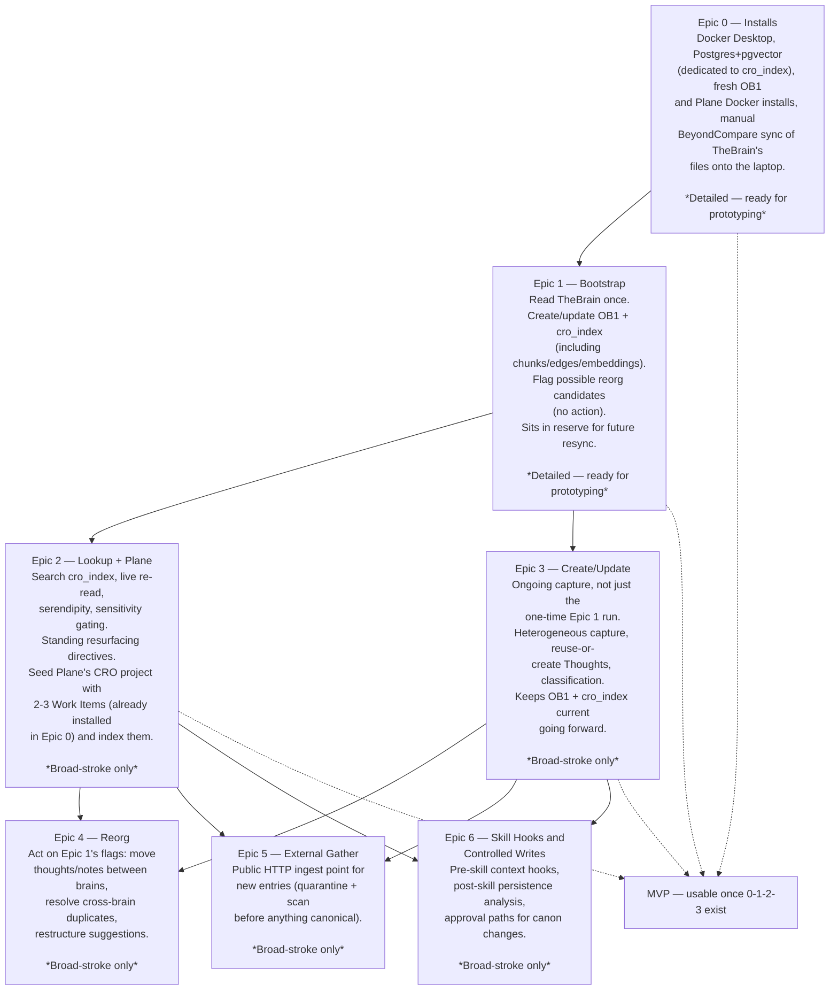

# CRO Epic Roadmap

*(Formerly the "CRO Phase Roadmap." Renamed 2026-11-04 — these are
organized as Epics now, each breaking down into Features (see each
`docs/phase-N-plan.md`) and, eventually, User Stories/PBIs. File
names stay `phase-N-plan.md` for stable history.)*

Broad-stroke overview of all planned Epics. Epic 0 and Epic 1 are the
two detailed enough to move toward physical architecture, prototyping,
or an MVP build — Epics 2–6 are named and scoped at the 50,000-foot
level only (2026-11-04) and each needs its own detailed planning pass,
the same way Epic 1 got one (live field verification against the real
TheBrain/OB1/Plane APIs, a real schema, real acceptance tests) before
it's buildable.

Epics 0–3 together are the usable MVP. Epics 4–6 extend it.

**A note on where this content came from.** This repo had an older,
separate 0-5 delivery plan (`docs/README.md` §15, written 2026-10-11,
now superseded) whose numbers collided with this Epic list — same
numbers, different content. Rather than just relabeling the collision
away, that old plan's real designed content was folded into the
correct Epic below wherever it fit; nothing was discarded. See
"Where the old plan's content went" at the bottom of this doc.

## Diagram

## Epic summary

| Epic | Name | Scope, one line | Status |
|---|---|---|---|
| 0 | Installs | Docker Desktop, dedicated Postgres+pgvector, fresh OB1 + Plane installs, manual TheBrain file sync | **Detailed — `docs/phase-0-plan.md`** |
| 1 | Bootstrap | One-time: read TheBrain, write OB1 + `cro_index` (nodes, chunks, edges), flag reorg candidates | **Detailed — `docs/phase-1-plan.md`, awaiting approval** |
| 2 | Lookup + Plane | Search capability; standing resurfacing directives; seed and index Plane's CRO project | Broad-stroke — `docs/phase-2-plan.md` |
| 3 | Create/Update | Ongoing capture (not one-time); heterogeneous input, classification | Broad-stroke — `docs/phase-3-plan.md` |
| 4 | Reorg | Act on Epic 1's flags — move/merge for real, restructure suggestions | Broad-stroke — `docs/phase-4-plan.md` |
| 5 | External Gather | Public HTTP ingest point for new entries | Broad-stroke — `docs/phase-5-plan.md` |
| 6 | Skill Hooks and Controlled Writes | How skills call CRO for context and report persistence decisions back | Broad-stroke — `docs/phase-6-plan.md` |

## Cross-cutting decisions (apply to every Epic, not just one)

### Implementation language and dependencies

**C# / .NET**, chosen over the earlier draft TypeScript recommendation
— the user is a C# developer and can actually review this code over
the years it will run. None of OB1's own source is reused directly
(CRO only talks to it as a REST client), so matching OB1's
implementation language was a convenience argument, not a real
requirement.

- **Hosting:** Kestrel (ASP.NET Core's native host) — not OWIN, the
  older, largely superseded .NET hosting standard.
- **Endpoints:** minimal API handlers, no MVC controllers.
- **Organization:** vertical slice architecture — code grouped by
  feature (endpoint + request + handler + validation together), not
  by technical layer. Tight coupling inside a slice is expected; low
  coupling between slices. Shared cross-cutting concerns (logging,
  auth, validation) go into endpoint filters/middleware, not a shared
  service layer that re-couples everything.
- **CQRS/mediator band:** both **MediatR** and **Mediator** kept open
  as options, decided per-slice as the app is built — not locked in
  now.
  - `MediatR` went commercial at v13 (dual-licensed; free community
    tier for personal/small use under $5M revenue) — fine for this
    project's scale, but a known constraint, not a silent surprise.
  - `Mediator` is the MIT-licensed, source-generator-based,
    AOT-friendly alternative with a near-identical API — the safer
    default if licensing terms ever matter.
  - CQRS/Event Sourcing may be used where it genuinely fits (e.g., the
    `cro_index` rebuild-from-source flow has an event-sourced flavor
    already, per the "disposable index" rule) — not mandated
    project-wide.
- **Validation:** FluentValidation.
- **Logging/instrumentation:** Serilog, sinking to the **already-
  running local Seq container** (`weatherstation-seq`,
  `datalust/seq:latest`, ports 5341/8080) — either shared with the
  existing weather-station project's logs or a second dedicated Seq
  instance if the user prefers not to mix them.
- **Data access:** Npgsql for Postgres + pgvector.
- **Local embeddings (settled 2026-11-04, refined 2026-11-04):**
  `ElBruno.LocalEmbeddings` (NuGet), default `all-MiniLM-L6-v2` model
  via ONNX Runtime, 384 dimensions, in-process, no network call. Built
  on `Microsoft.Extensions.AI`'s `IEmbeddingGenerator` abstraction,
  which is interfaces only — no model or compute in the namespace
  itself. Kept on the CPU execution provider — not a GPU ban, just
  unneeded for a model this small. **Only the tablet half's integrated
  GPU is off-limits** (per the user's actual Surface Book 2 history —
  a battery/display-panel heat problem while gaming on AC power, not
  a general "GPU load" issue); the base's GTX 1660 Ti is allowed for
  anything that would genuinely benefit from it, if explicitly pinned
  there (via Windows' per-app Graphics preference, or the container
  equivalent) — see `CURRENT.md`'s non-negotiables. Full detail:
  `docs/cro-index-schema.md`'s `chunks` table.

### Schema

The draft `cro_index` Supabase/pgvector schema, settled table-by-table
through live verification against the real TheBrain, OB1, and Plane
APIs. Full detail in `docs/cro-index-schema.md`. Sized against a
645,000-item scale target (Jerry's Brain), independently validated
against two separate working OB1 implementations found in the
integration survey (`docs/ob1-integration-survey.md`).

### Lookup-table resync (added 2026-11-04)

A standing startup step, run before *any* Epic that touches TheBrain
— not a one-time Epic 1 task. `brains` and `thebrain_types` (see
`docs/cro-index-schema.md`) both hold TheBrain's own freeform,
user-editable lists (confirmed live: 8 real Types just in the Growth
brain, and the brain count itself grew during this planning pass).
Epic 1's bootstrap, Epic 3's ongoing create/update, and Epic 4's
reorg all depend on these two tables being current against TheBrain's
live state, not just populated once at the start. Not yet assigned to
a specific step in any Epic doc — needs doing before Epic 1 is built,
since Epic 1's own bootstrap is the first thing that would populate
these tables.

### Plane work-item hierarchy convention (added 2026-11-04)

Plane itself has no native Epic/Feature/User-Story (or PBI) work item
types — only generic work items with parent/child links. The
convention for organizing this project's Plane work once Epic 0 and
Epic 2 stand it up:

- **Hierarchy via parent/child links**, not a type field — a Feature
  is a child work item of its Epic; a User Story/PBI is a child of
  its Feature.
- **Level marked by a tag**, since Plane has no type field for this:
  `EPIC`, `FEATURE`, `USER STORY` (or `PBI` — pick one and use it
  consistently; not yet decided which).
- This Epic-roadmap doc and each `docs/phase-N-plan.md`'s "Features"
  section are the source material for actually creating these Plane
  work items — not done yet, Plane itself doesn't exist until Epic 0
  runs.
- **Folder structure mirrors this hierarchy directly (added
  2026-11-04):** `docs/Epic N - Title/` holds one subfolder per Epic.
  Epic 0's is fully broken out — `Feature 01 - Title.md` through
  `Feature 09 - Title.md`, one per install+test item in
  `docs/phase-0-plan.md`. The other Epics still have just a `README.md`
  pointing back to their `docs/phase-N-plan.md` until they get the
  same treatment. When a Feature file gets broken down further, a
  `User Story NN - Title.md` (or `PBI NN - Title.md`) pattern inside
  the same Epic folder would be the natural next step — not done
  anywhere yet.

### Developer-facing architecture review and package

A standing, cross-Epic documentation task, not scoped to one Epic:

- Review every existing architecture document and decision
  (`docs/README.md`, the design handoff, the design addendum, ADR
  0001, `docs/capability-matrix.md`, `DECISIONS.md`) for consistency
  and completeness as each Epic lands.
- Keep the architecture diagram set in Mermaid (`docs/architecture/
  *.mmd`) matching every settled decision.
- Keep a single developer-facing package (one doc, linking the
  diagrams) written for someone joining the project cold — a future
  developer team, not just Keith.
- Documentation only. Never changes a settled decision; only presents
  it.

## Known gaps not yet placed in any Epic

- **Backup/disaster-recovery for the laptop-only setup.** CRO (and the
  local OB1 it writes to) now runs on the laptop only — see
  `CURRENT.md`'s non-negotiables. `cro_index` is disposable by design;
  OB1's actual captured data from Epic 3 onward is not. No plan yet
  for what happens if that laptop's drive fails.
- **Auth on the LAN-exposed MCP/API surface.** Previously
  localhost-only; now reachable from the desktop over the LAN too.
  "Anyone on the home network" is the real trust boundary now, not
  "this one machine." No deliberate decision made yet, even to accept
  the risk as-is.

(Standing resurfacing directives, previously listed here, is now
homed in Epic 2 — see "Where the old plan's content went" below.)

## Where the old plan's content went (2026-11-04 reconciliation)

`docs/README.md` §15 had its own 0-5 delivery plan, written
2026-10-11, whose numbers collided with this Epic list — same
numbers, entirely different content. No direct contradictions were
found with anything decided since; the old plan is marked superseded
in `docs/README.md` itself, and its real content is now homed here:

| Old §15 phase | What it actually covered | Where it lives now |
|---|---|---|
| 0: Technical discovery and contract design | TheBrain/OB1 capability discovery (completed), schema groundwork | Superseded by this Epic list's own live-verification passes (Epic 0/1) — same kind of work, already redone and extended |
| 1: Read-only context recall | Adapters, assemble context packets, **serve a client**, provenance, serendipity cap 2 | Split: "populate" → Epic 1; "serve a client," provenance, and the serendipity-cap-2 rule → Epic 2's Features |
| 2: General capture | Heterogeneous capture inputs, reuse-or-create Thoughts, preserve attachments, capture loose ideas in OB1, report project impact without changing canon | Epic 3's Features (almost the entire old phase, nearly verbatim) |
| 3: Recovery and graph hygiene | Duplicate/orphan/stale-node/hub detection, reviewable relationship suggestions | Split: detection → Epic 1's Features; the "reviewable suggestions" resolution half → Epic 4's Features |
| 4: Relevance and resurfacing | Standing directives, stale/supersession review, forgotten-item resurfacing | Epic 2's Features, as "Standing resurfacing directives" — previously sat in this doc's "known gaps" list unplaced; the old plan turned out to already have real designed content for it |
| 5: Skill hooks and controlled project writes | Pre-skill context hooks, post-skill persistence analysis, approval paths, audit retention | New **Epic 6**, built almost entirely from this old phase |
